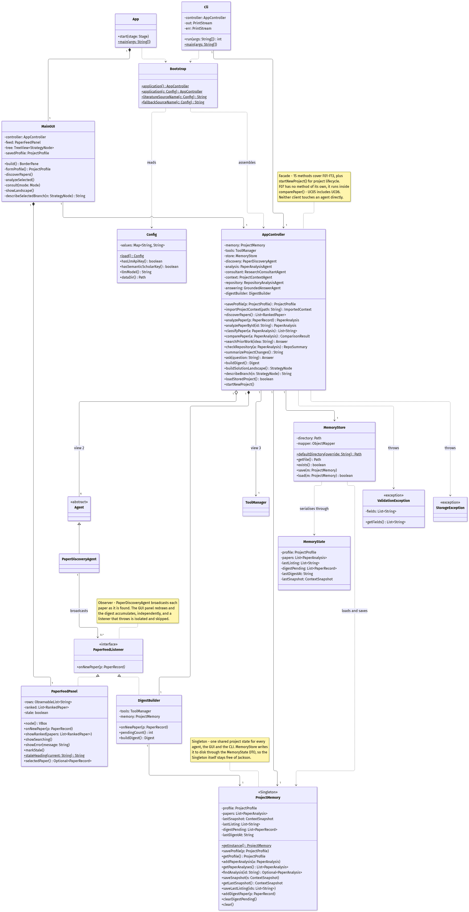
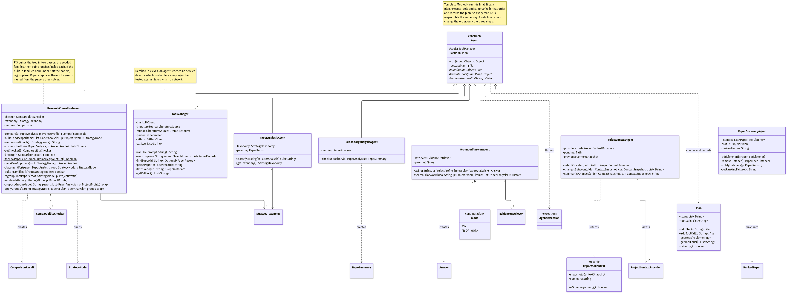
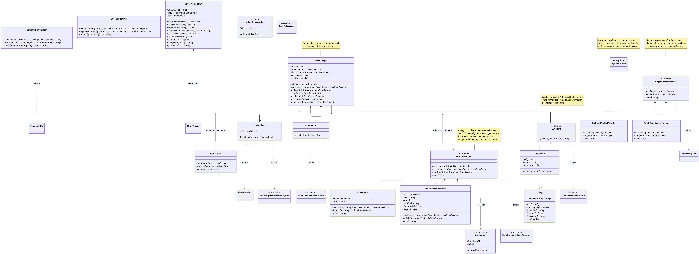
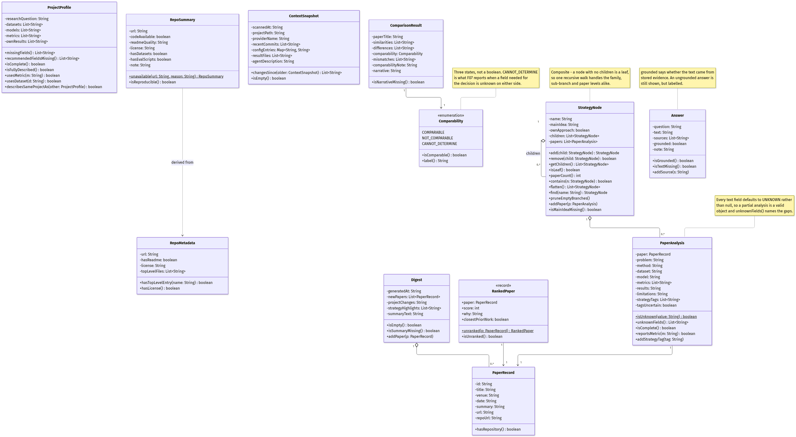

# Stage 2 Implementation Report — Project-Aware Research Consultant

| | |
|---|---|
| **Course** | EECS 3311 Software Design, Fall 2026, York University |
| **Student** | Kiavash Azimi |
| **Repository** | https://github.com/kiavashazimi/EECS3311_Project |
| **Stage 1 report** | `docs/STAGE1.md` |
| **Date** | November 2026 |

> **Before submission — three placeholders remain in this report.**
> Section 5 needs the token and dollar totals from the Anthropic console. Sections 2
> and 7 need the demonstration video links. Every `[TO BE FILLED]` marker below is one
> of these. Nothing else in this report is a placeholder; everything else describes
> code that is in the repository and runs.

---

## 1. Project overview and implementation status

### What it is

A desktop and command-line research assistant for someone running an experimental
project. Generic literature search does not know anything about the researcher's own
work, so it cannot say *this paper matters for you*, and it certainly cannot say *your
numbers are not comparable to theirs*. This application keeps a structured memory of one
project — the research question, datasets, models, metrics and the researcher's own
results — and uses that memory as the lens for everything it does: which papers it
surfaces, how it ranks them, what it says about them, and whether it is willing to place
their results beside yours.

### Users

Graduate students and researchers actively running an experimental project who need to
stay current without re-reading the field every week. The application is single-user and
single-project by design: one profile, one memory file.

### AI and LLM integration

The model is Claude, reached through the Anthropic Java SDK (`com.anthropic:anthropic-java:3.2.0`),
default model `claude-sonnet-5-5`. It is reached **only** through the `LLMClient`
interface. No GUI class, CLI class or deterministic service ever calls the model
directly; every call goes `Agent → ToolManager.callLLM() → LLMClient → ClaudeClient`.

The AI is not a pass-through. Six agents extend a `Agent` Template Method that forces
every one of them through plan → tool use → summarise, and the plan each agent built is
recorded and inspectable afterwards (`Agent.getLastPlan()`). Across the thirteen features
the model does query planning, multi-step retrieval, structured extraction from paper
text, classification against a controlled taxonomy, comparison reasoning, grouping, and
summarisation — and in several places its answer is *checked* rather than trusted:

- **F05** classification: tags the model returns are matched against `StrategyTaxonomy`,
  and unrecognised tags set an `tagsUncertain` flag rather than entering the vocabulary.
- **F07** comparability: the verdict is computed deterministically by
  `ComparabilityChecker` **before** the model writes anything, and the model is given the
  verdict to explain, not asked to decide it.
- **F09** reusability: derived from the repository's actual file listing, not from the
  model's opinion of the repository.
- **F13** placement: a paper whose tags are uncertain is placed under an explicit
  unclassified branch rather than into the nearest-looking family.

### Working functionality

**All thirteen Stage 1 features are implemented and work from both the GUI and the CLI.**
None was dropped. The minimum is ten; nothing was omitted to reach it.

| | Feature | Status |
|---|---|---|
| F01 | Project profile setup | Implemented, modified (C24) |
| F02 | Import project context | Implemented, extended (C13) |
| F03 | Discover new papers | Implemented, modified (C10) |
| F04 | Analyze a paper | Implemented, modified (C11) |
| F05 | Classify paper by strategy | Implemented, modified (C11) |
| F06 | Compare paper to own project | Implemented (C12) |
| F07 | Comparability check | Implemented, modified (C01, C12) |
| F08 | "Has anyone tried this" search | Implemented, merged agent (C18) |
| F09 | Repository analysis | Implemented, modified (C15) |
| F10 | Project change summary | Implemented |
| F11 | Project-aware chat | Implemented, merged agent (C18) |
| F12 | Weekly digest | Implemented, modified (C19) |
| F13 | Solution landscape | Implemented, substantially extended (C14, C26) |

Seven design patterns are in running code; the requirement is five.

**Verification at the submitted commit:** 573 tests pass, 0 failures, 0 errors, 4 skipped.
The four skipped tests are the live network and live API tests, which are disabled by
default so that `mvn test` never spends money or depends on a third-party service.

### Limitations and incomplete functionality, stated honestly

1. **F13's grouping is not reproducible.** The sub-branches under each family are proposed
   by the model, and two runs over the same papers can produce different group names and
   a different number of groups. The tree is therefore derived state, rebuilt on demand
   and never persisted (C14). A demonstration should press *Strategies* once, not twice.

2. **F04 analyses the abstract, not the full PDF.** `PaperParser` reads the abstract and
   metadata that the literature source returns. Full-text PDF extraction was scoped out
   (C11). Fields the abstract does not state come back as `UNKNOWN`, which is visible in
   the UI rather than hidden, and which then correctly drives F07 to `CANNOT_DETERMINE`.

3. **Semantic Scholar is rate limited to roughly one request per second**, with HTTP 429
   as its normal rather than exceptional failure. `discover` consequently takes around a
   minute. The runtime fallback to arXiv exists for exactly this reason (C20).

4. **`PaperFeedPanel.showError()` claims previous papers were kept**, but `showSearching()`
   has already cleared the list by the time an error can arrive. The message is wrong; the
   behaviour is not harmful. Known and not fixed.

5. **One commit period was missed.** The repository has no commits between October 20 and
   26. See section 6.

6. **There is no scheduler.** SD08 in the Stage 1 design shows the digest also firing on a
   schedule. A desktop application the user starts and stops is not running when such a
   schedule would fire, so the digest is only ever built on demand (C19). That one branch
   of SD08 is unimplemented and is called out in section 3.

7. **Stage 3 work is not here.** Deterministic test coverage beyond the current suite, and
   the KUMA agent validation, remain Stage 3 requirements.

---

## 2. Feature to implementation mapping

Source paths below are relative to `src/main/java/ca/yorku/eecs3311/consultant/`.
Every feature is reachable from both clients: `MainGUI` for the GUI and `Cli` for the
command line, both through the `AppController` facade and never around it.

---

### F01 — Project Profile Setup

| Field | Entry |
|---|---|
| Stage 1 reference | F01 |
| Status | **Implemented, modified** — see C24 |
| Classes and responsibilities | `domain/ProjectProfile` holds the five fields and owns its own validation rules. `controller/AppController` validates before storing, so a rejected profile cannot half-update the live project. `memory/ProjectMemory` holds the single live copy. `memory/MemoryStore` writes it to JSON. `controller/ValidationException` carries the names of the blocking fields; `controller/StorageException` separates "rejected" from "accepted but could not be written". `app/MainGUI` renders the form; `cli/Cli` implements `profile set` and `profile show`. |
| Key methods | `ProjectProfile.missingFields()`, `recommendedFieldsMissing()`, `isComplete()`, `isFullyDescribed()`, `describesSameProjectAs()`; `AppController.saveProfile()`; `MemoryStore.save()`; `MainGUI.formProfile()` |
| Design patterns | Facade (`AppController`), Singleton (`ProjectMemory`) |
| Determinism | **Deterministic.** No model call. |
| Video | [TO BE FILLED] |

**Collaboration.** The user fills the form or passes `--question`. `MainGUI.formProfile()`
builds a `ProjectProfile` and hands it to `AppController.saveProfile()`, which asks the
profile object itself which required fields are missing. If any are, it throws
`ValidationException` **before** touching `ProjectMemory` — the ordering is the entire
point of SD01, because a half-saved profile would silently corrupt every later feature
that reads it. Only once validation passes does the controller store the profile in the
singleton and ask `MemoryStore` to write it. A write failure after a successful validation
raises `StorageException`, which says the in-memory state changed but the disk did not —
a different situation from a rejection, and reported differently.

---

### F02 — Import Project Context

| Field | Entry |
|---|---|
| Stage 1 reference | F02 |
| Status | **Implemented and extended** — the second provider, treated in Stage 1 as a stretch goal, was built (C13) |
| Classes and responsibilities | `agent/ProjectContextAgent` runs the import and picks a provider. `context/ProjectContextProvider` is the interface both sources satisfy. `context/FileBasedContextProvider` reads git history, config files and result files directly, redacting anything that looks like a secret. `context/ClaudeCodeContextProvider` delegates to a coding agent already working in that directory and returns what the project is *doing*, which a file diff cannot express. `domain/ContextSnapshot` is the result both produce. |
| Key methods | `ProjectContextAgent.selectProvider()`, `plan()`, `executeTools()`, `summarize()`; `ProjectContextProvider.isAvailable()`, `scan()`, `name()`; `AppController.importProjectContext()` |
| Design patterns | **Adapter** (two providers behind one interface), Template Method, Facade |
| Determinism | **Hybrid.** Scanning is deterministic; the description of what the project is doing is AI. |
| Video | [TO BE FILLED] |

**Collaboration.** `AppController.importProjectContext(path)` passes the path to
`ProjectContextAgent`. Its `plan()` step calls `selectProvider()`, which probes each
provider in order with `isAvailable()` — the Claude Code provider first, the file-based
one as the fallback. The chosen provider's `scan()` returns a `ContextSnapshot` stamped
with `providerName`, so the researcher can always see which kind of context they are
looking at. The snapshot is stored in `ProjectMemory` and becomes the baseline that F10
diffs against next time. An unreadable directory fails the import with nothing stored; a
directory that is simply not a git repository degrades to whatever could be read.

---

### F03 — Discover New Papers

| Field | Entry |
|---|---|
| Stage 1 reference | F03 |
| Status | **Implemented, modified** — returns ranked papers with a reason each (C10) |
| Classes and responsibilities | `agent/PaperDiscoveryAgent` plans the query, searches, and ranks the results against the profile. `literature/LiteratureSource` is the Strategy interface; `ArxivSource` and `SemanticScholarSource` implement it. `literature/SearchIntent` selects newest-first or best-match ordering. `literature/QueryTerms` widens a query that returned nothing by dropping its last term. `domain/RankedPaper` carries the score and the reason. `agent/PaperFeedListener` is broadcast to as each paper arrives. |
| Key methods | `PaperDiscoveryAgent.plan()`, `executeTools()`, `summarize()`, `notifyListeners()`, `getRankingFailure()`; `ToolManager.search()`; `QueryTerms.dropLastTerm()`; `PaperFeedPanel.showRanked()` |
| Design patterns | **Strategy** (`LiteratureSource`), **Observer** (`PaperFeedListener`), Template Method, Facade |
| Determinism | **Hybrid.** Retrieval is deterministic; query planning and relevance ranking are AI. |
| Video | [TO BE FILLED] |

**Collaboration.** `AppController.discoverPapers()` runs the agent. `plan()` asks the model
to turn the research question into a literature query in the small term syntax the sources
accept (quoted phrases stay whole, `field:value` passes through). `executeTools()` calls
`ToolManager.search()`, which tries the primary source and falls back to the secondary one
if it fails. An empty result is widened by `QueryTerms.dropLastTerm()` and retried rather
than reported as "nothing exists". `summarize()` asks the model to score each paper
against the profile and say why in one line; if that call fails, the papers are still
returned, unranked, with `getRankingFailure()` explaining why. Each paper is then
broadcast to every registered `PaperFeedListener` — the GUI feed redraws and the digest
accumulates, independently.

---

### F04 — Analyze a Paper

| Field | Entry |
|---|---|
| Stage 1 reference | F04 |
| Status | **Implemented, modified** — abstract rather than full PDF (C11) |
| Classes and responsibilities | `agent/PaperAnalysisAgent` extracts the structured record. `analysis/PaperParser` turns a `PaperRecord` into text to analyse. `domain/PaperAnalysis` is the structured result, with every text field defaulting to `UNKNOWN` rather than null. `analysis/UnparseablePaperException` is the failure. |
| Key methods | `PaperAnalysisAgent.plan()`, `executeTools()`, `summarize()`; `ToolManager.parsePaper()`; `PaperAnalysis.unknownFields()`, `isComplete()`, `isUnknown()`; `AppController.analyzePaper()`, `analyzePaperById()` |
| Design patterns | Template Method, Facade |
| Determinism | **AI**, with a deterministic container. |
| Video | [TO BE FILLED] |

**Collaboration.** The user selects a paper in the feed, or names it by arXiv id or by the
row number the last listing printed (C16). `PaperAnalysisAgent.executeTools()` parses the
paper to text and asks the model for the seven fields as JSON. Anything the model does not
supply stays `UNKNOWN` — a deliberate choice, because `unknownFields()` then names the gaps
in the UI, and F07 reads those gaps to answer `CANNOT_DETERMINE` instead of guessing. A
partial analysis is a valid object and is stored; the feature does not fail because a
paper's abstract did not mention its split.

---

### F05 — Classify Paper by Strategy

| Field | Entry |
|---|---|
| Stage 1 reference | F05 |
| Status | **Implemented, modified** — model output is checked against a taxonomy (C11) |
| Classes and responsibilities | `agent/PaperAnalysisAgent.classifyExisting()` runs the classification. `analysis/StrategyTaxonomy` holds the controlled vocabulary, canonicalises variant spellings, and answers which family a tag belongs to. `domain/PaperAnalysis.strategyTags` and `tagsUncertain` hold the result. |
| Key methods | `PaperAnalysisAgent.classifyExisting()`; `StrategyTaxonomy.match()`, `isKnown()`, `canonical()`, `familyOf()`; `PaperAnalysis.addStrategyTag()`, `isTagsUncertain()`; `AppController.classifyPaper()` |
| Design patterns | Template Method, Facade |
| Determinism | **Hybrid.** The model proposes; the taxonomy decides what is accepted. |
| Video | [TO BE FILLED] |

**Collaboration.** The model is asked which strategies the paper's method section
describes. Each returned tag goes through `StrategyTaxonomy.canonical()` so that spelling
variants collapse to one term, and `isKnown()` decides whether it is a recognised strategy.
A tag the taxonomy does not recognise does **not** silently enter the vocabulary: it sets
`tagsUncertain`, which the UI shows and which F13 then honours by refusing to file that
paper into a family on the strength of a tag nobody vouched for. This flag earned its
keep: three education papers were tagged `reinforcement learning`, `curriculum learning`
and `active learning` purely by term collision, and the flag is what keeps them out of the
machine-learning branches.

---

### F06 — Compare Paper to Own Project

| Field | Entry |
|---|---|
| Stage 1 reference | F06 |
| Status | **Implemented** (C12) |
| Classes and responsibilities | `agent/ResearchConsultantAgent.compare()` produces the comparison. `domain/ComparisonResult` holds similarities, differences, the comparability verdict, the specific mismatches and the narrative. `analysis/ComparabilityChecker` supplies the verdict (F07, included). |
| Key methods | `ResearchConsultantAgent.compare()`, `plan()`, `executeTools()`, `summarize()`, `linesUp()`, `mismatchesFor()`; `AppController.comparePaper()` |
| Design patterns | Template Method, Facade |
| Determinism | **Hybrid.** The verdict is deterministic, the prose is AI. |
| Video | [TO BE FILLED] |

**Collaboration.** `AppController.comparePaper()` passes the stored analysis and the
profile to the agent. `executeTools()` first runs `ComparabilityChecker` — the F07
`<<include>>` from UC05 to UC06, which is why F07 has no facade method of its own — and
only then asks the model to write the similarities, differences and narrative, with the
verdict already fixed and supplied to it. `linesUp()` checks that the model's prose did
not contradict the computed verdict. If the profile is missing fields the comparison needs,
the agent reports which fields rather than inventing them.

---

### F07 — Comparability Check

| Field | Entry |
|---|---|
| Stage 1 reference | F07 |
| Status | **Implemented, modified** — three-valued enum instead of a boolean (C01), verdict computed before generation (C12) |
| Classes and responsibilities | `analysis/ComparabilityChecker` is the deterministic matcher, including an alias table so that `AUROC` and `AUC` are recognised as the same metric. `domain/Comparability` is the three-valued verdict. `domain/ComparisonResult` carries it with the specific mismatches. |
| Key methods | `ComparabilityChecker.isComparable()`, `findMismatches()`, `explain()`; `Comparability.isComparable()`, `label()` |
| Design patterns | N/A — a deterministic domain service by design. Reached through the Facade. |
| Determinism | **Hybrid.** Verdict deterministic, explanation AI. |
| Video | [TO BE FILLED] |

**Collaboration.** Executes inside `comparePaper()`, matching UC05's `<<include>>` of UC06.
The checker compares dataset, metric and split across the paper's analysis and the
profile. A field that is `UNKNOWN` on either side produces `CANNOT_DETERMINE`, never a
match and never a mismatch — the distinction the feature exists to preserve, and the
reason the Stage 1 `Boolean` had to become an enum. A `null` read as `false` would have
turned *we do not know* into *not comparable*, which is a different and wrong claim.

---

### F08 — "Has Anyone Tried This" Search

| Field | Entry |
|---|---|
| Stage 1 reference | F08 |
| Status | **Implemented**, as one agent shared with F11 (C18) |
| Classes and responsibilities | `agent/GroundedAnswerAgent` in `Mode.PRIOR_WORK`. `analysis/EvidenceRetriever` selects which stored analyses and which freshly found papers are relevant, by term overlap. `domain/Answer` carries the text, the sources, a `grounded` flag and a note naming the terms searched for. |
| Key methods | `GroundedAnswerAgent.searchPriorWork()`; `EvidenceRetriever.relevantTo()`, `papersRelevantTo()`, `termsOf()`; `Answer.isGrounded()`, `addSource()`; `AppController.searchPriorWork()` |
| Design patterns | Template Method, Strategy (the literature search underneath), Facade |
| Determinism | **Hybrid.** Retrieval deterministic, synthesis AI. |
| Video | [TO BE FILLED] |

**Collaboration.** The idea text is reduced to search terms by `EvidenceRetriever.termsOf()`,
which strips stopwords and short tokens. Those terms are searched against both the live
literature and the stored analyses. The model is then asked to synthesise **only** from
what was retrieved. The answer always states the terms it searched for — added after a
live defect in which two typos in a research question silently removed half the search
terms and the user could not see why the results looked unrelated (C23). No matches is
reported as *no matches found for these terms*, never as *no one has tried this*.

---

### F09 — Repository Analysis

| Field | Entry |
|---|---|
| Stage 1 reference | F09 |
| Status | **Implemented, modified** — verdict derived from the listing, not judged by the model (C15) |
| Classes and responsibilities | `agent/RepositoryAnalysisAgent` runs the check. `repo/GitHubClient` fetches repository metadata through the GitHub API. `domain/RepoMetadata` is the raw metadata; `domain/RepoSummary` is the reusability verdict. `repo/RepositoryUnavailableException` covers private, missing and unreachable repositories. |
| Key methods | `RepositoryAnalysisAgent.checkRepository()`; `GitHubClient.fetchRepo()`; `RepoMetadata.hasTopLevelEntry()`, `hasLicense()`; `RepoSummary.isReproducible()`, `unavailable()`; `AppController.checkRepository()` |
| Design patterns | Template Method, Facade |
| Determinism | **Hybrid.** Metadata and verdict deterministic, summary AI. |
| Video | [TO BE FILLED] |

**Collaboration.** The agent reads **API metadata only**. Code from a paper's repository is
never downloaded and never executed — a standing constraint of this project, not an
incidental one. Whether code, datasets and evaluation scripts are present is decided by
matching the top-level file listing against known suffixes and directory names, so the
verdict is checkable rather than asserted. A paper with no repository is reported plainly
as having none, which is different from a repository that could not be reached.

---

### F10 — Project Change Summary

| Field | Entry |
|---|---|
| Stage 1 reference | F10 |
| Status | **Implemented** |
| Classes and responsibilities | `agent/ProjectContextAgent.changesBetween()` and `summarizeChanges()`. `domain/ContextSnapshot.changesSince()` computes the diff between two scans. `memory/ProjectMemory` holds the previous snapshot. |
| Key methods | `ContextSnapshot.changesSince()`, `isEmpty()`; `ProjectContextAgent.changesBetween()`, `summarizeChanges()`; `AppController.summarizeProjectChanges()`, `projectChanges()` |
| Design patterns | Adapter, Template Method, Facade |
| Determinism | **Hybrid.** Diff deterministic, prose AI. |
| Video | [TO BE FILLED] |

**Collaboration.** A fresh scan is diffed against the snapshot stored at the last import.
`changesSince()` reports added and removed commits, changed config entries and new result
files; the model turns that list into a sentence. With no prior scan there is nothing to
diff and the feature says so and points at F02, rather than presenting the first scan as
if everything in the project were new.

---

### F11 — Project-Aware Chat

| Field | Entry |
|---|---|
| Stage 1 reference | F11 |
| Status | **Implemented**, as one agent shared with F08 (C18) |
| Classes and responsibilities | `agent/GroundedAnswerAgent` in `Mode.ASK`. `analysis/EvidenceRetriever` retrieves from stored analyses only — this mode does not search the live literature. `domain/Answer` carries the grounding flag and sources. |
| Key methods | `GroundedAnswerAgent.ask()`; `EvidenceRetriever.relevantTo()`; `Answer.isGrounded()`, `isTextMissing()`; `AppController.ask()` |
| Design patterns | Template Method, Facade |
| Determinism | **Hybrid.** Retrieval deterministic, answer AI. |
| Video | [TO BE FILLED] |

**Collaboration.** The question is reduced to terms, the stored analyses are scored by term
overlap, and only the matching records are put in front of the model. When nothing matches,
the agent says that no stored record is relevant rather than answering from the model's
general knowledge — the `grounded` flag on `Answer` records which of the two happened, and
the UI labels an ungrounded answer as such instead of hiding it.

---

### F12 — Weekly Digest

| Field | Entry |
|---|---|
| Stage 1 reference | F12 |
| Status | **Implemented, modified** — accumulated by the Observer rather than scheduled (C19) |
| Classes and responsibilities | `agent/DigestBuilder` is the second `PaperFeedListener`: it accumulates papers as discovery finds them and composes the digest on demand. `domain/Digest` holds the new papers, the strategy highlights, the project changes and the summary text. `memory/ProjectMemory` holds the pending list and the last digest timestamp, so the digest survives a restart. |
| Key methods | `DigestBuilder.onNewPaper()`, `pendingCount()`, `buildDigest()`; `ProjectMemory.addDigestPaper()`, `clearDigestPending()`, `getLastDigestAt()`; `AppController.buildDigest()`, `papersAwaitingDigest()` |
| Design patterns | **Observer** (consumer side), Singleton, Facade |
| Determinism | **Hybrid.** Assembly deterministic, summary AI. |
| Video | [TO BE FILLED] |

**Collaboration.** `DigestBuilder` is registered as a listener by `AppController`'s
constructor, not by a client — so the digest is collecting during every discovery, no
matter which client started it. Each discovered paper is appended to the pending list in
project memory. `buildDigest()` combines that list with the project changes since the last
digest and asks the model for the summary, then clears the pending list and stamps the
time. Nothing new is reported as nothing new, explicitly.

---

### F13 — Solution Landscape

| Field | Entry |
|---|---|
| Stage 1 reference | F13 |
| Status | **Implemented, substantially extended** — derived rather than persisted (C14), and the adaptive half specified in Stage 1 was built (C26) |
| Classes and responsibilities | `agent/ResearchConsultantAgent.buildLandscape()` builds the tree. `domain/StrategyNode` is the Composite node. `analysis/StrategyTaxonomy` seeds the top-level families and answers `familyOf()`. `app/MainGUI` renders it as a `TreeView`. |
| Key methods | `buildLandscape()`, `summarizeBranch()`, `placementFor()`, `builtInFamiliesFit()`, `regroupFromPapers()`, `subdivide()`, `proposeGroups()`, `applyGroups()`, `markOwnApproach()`; `StrategyNode.add()`, `find()`, `flatten()`, `paperCount()`, `pruneEmptyBranches()`; `AppController.buildSolutionLandscape()`, `describeBranch()` |
| Design patterns | **Composite** (`StrategyNode`), Template Method, Facade |
| Determinism | **Hybrid**, and the least deterministic feature in the system. |
| Video | [TO BE FILLED] |

**Collaboration.** `StrategyTaxonomy.seedRoots()` creates the fixed families. Each analysed
paper is placed by `placementFor()`, which refuses to place a paper whose tags are
uncertain and otherwise takes a majority vote across its tags, breaking ties in taxonomy
order. Then the adaptive half: `builtInFamiliesFit()` asks whether the seeded families
actually hold at least half the papers. If they do, each family is subdivided into
model-proposed sub-branches. If they do not — which is what happens when the researcher's
field is not machine learning — `regroupFromPapers()` discards the seeded families and
asks the model to group the papers on their own terms. Papers are offered to the model by
position, never by id, and out-of-range or duplicate indexes are dropped; a paper the model
does not place stays on its parent rather than disappearing. Finally `markOwnApproach()`
flags the branch matching the profile. The whole tree is rebuilt on demand and never
persisted, because it is a view of the analyses, not a fact about them.

---

## 3. Implemented design patterns

Seven distinct patterns, all in running code. The requirement is five. None was added to
reach a count; each is justified below by the problem it solves and what the code would
have to do without it.

**Updated UML class diagrams** are in `docs/diagrams/`:

| View | File | Patterns visible |
|---|---|---|
| 1 | `class-diagram-stage2-app.png` | Facade, Observer, Singleton |
| 2 | `class-diagram-stage2-agents.png` | Template Method |
| 3 | `class-diagram-stage2-services.png` | Strategy, Adapter (both) |
| 4 | `class-diagram-stage2-domain.png` | Composite |

The four views together carry all 55 classes in `src/main/java`. The Stage 1 single-sheet
diagram (`class-diagram-render.png`) is unchanged and remains available for comparison; see
C27 for why the as-built diagram is four views rather than one. The images below are
reproduced at page width; the full-resolution files are in `docs/diagrams/` and the Mermaid
sources beside them.

**View 1 — clients, Facade, Observer, Singleton**

**View 2 — the Agent hierarchy (Template Method)**

**View 3 — services behind ToolManager (Strategy, Adapter)**

**View 4 — the domain model (Composite)**

The Stage 1 **use-case diagram and descriptions remain accurate**: no change in this stage
altered an actor, a use case, or an `<<include>>` or `<<extend>>` relationship.

The **sequence diagrams are accurate with one exception.** C12 and C18 are the two changes
worth checking against SD05 and SD06, and in both cases the implementation preserved the
ordering the diagram specifies, so neither needed redrawing. SD08 likewise already shows
`DigestBuilder` collecting papers as a `PaperFeedListener`, which is exactly what C19
implemented. The exception is SD08's `alt scheduled run` branch, which models the digest
also being triggered on a schedule with no user action. **There is no scheduler in the
implementation** — a desktop application the user starts and stops is not running when a
schedule would fire, so the digest is only ever built on demand from the GUI or `rc digest`.
That one branch of SD08 should be read as unimplemented; every other message in the nine
diagrams matches the code.

---

### 3.1 Facade — `AppController`

**Design problem.** Two clients, a GUI and a CLI, both need all thirteen features. Without
a facade each client would have to know which of six agents to construct, in what order to
call them, where the shared memory lives, and when to persist — and the two clients would
drift apart, which for a grader means the CLI quietly behaving differently from the GUI.

**Participants.** `controller/AppController` is the Facade. `app/MainGUI` and `cli/Cli` are
the clients. The subsystem is the six agents, `ToolManager`, `ProjectMemory` and
`MemoryStore`.

**Files and methods.** `controller/AppController.java`. Fifteen methods cover F01–F13;
`startNewProject()` is a sixteenth serving project lifecycle rather than a feature (C25).
F07 deliberately has no method of its own — it executes inside `comparePaper()`, which is
the `<<include>>` from UC05 to UC06 expressed in code.

**How it follows the pattern, and why it is useful.** Neither client holds a reference to
any agent, and neither can reach the memory singleton except through the controller. The
controller owns the ordering decisions that matter — validate before store, compute the
comparability verdict before generating prose, register the digest listener at construction
so the digest collects regardless of which client ran the discovery. The payoff is concrete:
when F01's validation rule was relaxed (C24), one method changed and both clients changed
with it.

**Matches Stage 1?** Yes, with the method list grown from twelve to sixteen as features
were implemented. Documented in C09 and C25.

---

### 3.2 Template Method — `Agent`

**Design problem.** Six agents each do something different, but all six must plan, then use
tools, then summarise, in that order, and all six must be inspectable afterwards. Letting
each agent write its own `run()` would mean six chances to skip planning, six chances to
forget to record what was done, and no uniform way to ask an agent what it did.

**Participants.** `agent/Agent` is the abstract class holding the template method.
`PaperDiscoveryAgent`, `PaperAnalysisAgent`, `ResearchConsultantAgent`,
`ProjectContextAgent`, `RepositoryAnalysisAgent` and `GroundedAnswerAgent` are the concrete
classes. `agent/Plan` is the recorded artefact.

**Files and methods.** `agent/Agent.java`. `run(Object)` is **final** and calls the three
protected abstract hooks `plan()`, `executeTools()` and `summarize()` in order, storing the
plan so `getLastPlan()` can return it.

**How it follows the pattern, and why it is useful.** The invariant lives in one place and
a subclass cannot reorder it — the `final` keyword is the enforcement, not a convention
(C05). Every agent is therefore inspectable the same way, which is what makes the AI
behaviour auditable rather than opaque. Adding a seventh agent means implementing three
methods, not re-deriving the control flow.

**Matches Stage 1?** Yes. `run()` was made `final` and two accessors were added during
implementation (C05).

---

### 3.3 Strategy — `LiteratureSource`

**Design problem.** arXiv and Semantic Scholar answer the same question with different
query semantics, different identifiers and different failure modes. Semantic Scholar ranks
a whole research question by relevance; arXiv ANDs its terms, so a compound question
narrows to nothing. Semantic Scholar also rate limits hard enough that HTTP 429 is its
normal failure. The system needs both, and needs to switch between them at runtime.

**Participants.** `literature/LiteratureSource` is the Strategy interface.
`literature/ArxivSource` and `literature/SemanticScholarSource` are the concrete strategies.
`agent/ToolManager` is the context that holds and swaps them.

**Files and methods.** `search(String, SearchIntent)`, `findById(String)` and `name()` on
the interface; `ToolManager.setLiteratureSource()`, `setFallbackLiteratureSource()` and
`search()`, which tries the primary and falls back on failure. `boot/Bootstrap` picks the
primary at startup from `Config`.

**How it follows the pattern, and why it is useful.** Every agent is written against the
interface and none knows which source answered. The fallback is a runtime substitution of
one strategy for another, which is the pattern doing real work rather than illustrating
itself. One detail is worth noting as design: `findById` is deliberately **not** a default
method. Before it existed, callers faked a lookup with `search("id:" + id)` — arXiv's
syntax — and Semantic Scholar read that as keywords and returned an unrelated paper, which
was then analysed and stored as the paper the user asked for. A default implementation
would have re-created exactly that assumption, so each source is forced to say how it looks
a paper up (C22).

**Matches Stage 1?** Yes, and extended: Stage 1 named one source, and the second was built
with a runtime fallback between them (C20).

---

### 3.4 Adapter — `LLMClient` and `ProjectContextProvider`

**Design problem, instance one.** Agents need a model, but must not depend on one vendor's
SDK, and `mvn test` must never make a paid call.

**Participants.** `llm/LLMClient` is the target interface; `llm/ClaudeClient` is the adapter
wrapping the Anthropic SDK; the agents are the clients. In the test suite `FakeLLMClient`
is a second implementation.

**Files and methods.** `llm/LLMClient.java`, one method: `generate(String)`. Failures surface
as the checked `LLMUnavailableException`, which forces each caller to write its degraded
path (C03).

**Design problem, instance two.** Project context can come from a coding agent that knows
what the project is *doing*, or from reading the directory, which knows only what the files
*say*. Both must look identical to the agent consuming them, and the choice must be made at
runtime.

**Participants.** `context/ProjectContextProvider` is the target interface;
`FileBasedContextProvider` and `ClaudeCodeContextProvider` are the adapters;
`ProjectContextAgent` is the client.

**Files and methods.** `isAvailable(Path)` probes, `scan(Path)` adapts, `name()` labels the
result so the researcher knows which source answered.

**How it follows the pattern, and why it is useful.** In both cases an interface the system
owns sits in front of something the system does not own. The LLM adapter is what makes
every agent testable with no network and no key — all 573 tests run offline. The context
adapter is what let the second provider be added as a new class rather than as a change to
`ProjectContextAgent`.

**Matches Stage 1?** Yes for both. Stage 1 treated `ClaudeCodeContextProvider` as a stretch
goal; it was built (C13).

---

### 3.5 Observer — `PaperFeedListener`

**Design problem.** When discovery finds papers, two unrelated things must happen: the GUI
feed redraws, and the digest accumulates. These have nothing to do with each other, and the
discovery agent should not know about either. The digest must also accumulate when the CLI
ran the discovery and no GUI exists at all.

**Participants.** `agent/PaperFeedListener` is the Observer interface.
`agent/PaperDiscoveryAgent` is the subject. `app/PaperFeedPanel` and `agent/DigestBuilder`
are the two concrete observers.

**Files and methods.** `onNewPaper(PaperRecord)`; `PaperDiscoveryAgent.addListener()`,
`removeListener()`, `notifyListeners()`.

**How it follows the pattern, and why it is useful.** The agent broadcasts and does not
care who listens. One listener lives in the GUI, the other does not, and the CLI registers
no GUI listener at all — the same discovery code serves both. The contract includes one
hard-learned rule: a listener that throws is isolated and skipped, because one broken
observer must not stop the others from being told.

**Matches Stage 1?** Yes, with the second observer added when F12 was implemented (C19).

---

### 3.6 Singleton — `ProjectMemory`

**Design problem.** Six agents, two clients and the persistence layer must all see exactly
one project state. Two instances would mean an analysis stored by one and invisible to the
other — a class of bug that would surface as "the paper I just analysed is not in the
landscape".

**Participants.** `memory/ProjectMemory` is the Singleton. `memory/MemoryStore` persists it.
`memory/MemoryState` is the serialisation DTO.

**Files and methods.** `getInstance()` via a static holder class, so initialisation is lazy
and thread-safe without synchronisation on the accessor. The mutating methods are
`synchronized`, because discovery runs on a background thread while the GUI reads on the
JavaFX thread.

**How it follows the pattern, and why it is useful.** One shared state with controlled
access, and `clear()` for starting a new project (C25). The DTO split is deliberate: the
Singleton itself stays free of Jackson annotations and of a public no-args constructor that
would undermine the single instance, and `MemoryState` carries the JSON concerns instead
(C02).

**Matches Stage 1?** Yes, with persistence added, which Stage 1 did not specify (C02).

---

### 3.7 Composite — `StrategyNode`

**Design problem.** The solution landscape is a tree of unknown depth: families, sub-branches
under them, and papers at the leaves. Code that walks it must not need to know whether the
node it is holding is a family, a sub-branch or a leaf.

**Participants.** `domain/StrategyNode` is both the component and the composite — a node
with no children simply is a leaf. `ResearchConsultantAgent` builds the tree; `MainGUI`
renders it as a `TreeView`.

**Files and methods.** `add()`, `remove()`, `getChildren()`, `isLeaf()`, `paperCount()`,
`contains()`, `flatten()`, `find()`, `pruneEmptyBranches()`.

**How it follows the pattern, and why it is useful.** `paperCount()` recurses over children
and papers alike; `flatten()` and `find()` traverse any depth with one implementation. This
is what made C26 cheap: adding a whole sub-branch layer beneath the families required no
change to counting, searching, pruning or rendering, because none of those ever knew how
deep the tree was.

**Matches Stage 1?** Yes. The tree gained a level during implementation (C26) and the
Composite absorbed it without modification, which is the pattern's own argument.

---

## 4. Changes and rationale

Twenty-seven changes from the Stage 1 design, each as
**Original design → Implemented change → Reason → Impact**. Nothing here is a silent
difference; every deviation found during implementation is listed.

---

**C01 — `ComparisonResult.comparable`: `Boolean` → `Comparability` enum.**
*Original:* the Stage 1 class diagram declares `comparable: Boolean`.
*Change:* a three-valued enum `{COMPARABLE, NOT_COMPARABLE, CANNOT_DETERMINE}`.
*Reason:* F07 requires three outcomes. A `Boolean` can express the third only as `null`,
and a `null` read as `false` turns *we do not know* into *not comparable* — a different and
wrong claim.
*Impact:* `ComparabilityChecker.isComparable()` returns the enum; both clients render
`Comparability.label()`; the default is `CANNOT_DETERMINE`, so a result can never
accidentally claim comparability it has not established. Affects F06, F07, UC05, UC06, SD05.

**C02 — Project memory is persisted to `~/.research-consultant/project-memory.json`.**
*Original:* Stage 1 names `ProjectMemory` as the singleton but never says where state lives
between runs.
*Change:* `MemoryStore` serialises through a `MemoryState` DTO to JSON in an absolute path.
*Reason:* a research project spans weeks; memory that dies with the process makes F10 and
F12 meaningless, since both are defined relative to *last time*.
*Impact:* new classes `MemoryStore` and `MemoryState`; the Singleton stays free of Jackson
concerns; the path is absolute so the GUI and CLI cannot end up with separate files.

**C03 — `LLMClient.generate()` throws a checked `LLMUnavailableException`.**
*Original:* Stage 1 declares `generate(prompt): String` with no failure mode.
*Change:* a checked exception.
*Reason:* every feature specification has a degraded path for model unavailability. An
unchecked exception makes those paths optional; a checked one makes the compiler ask for
them.
*Impact:* every agent has an explicit fallback. This is why discovery still returns papers
when ranking fails, and why the landscape still builds when summaries cannot be written.

**C04 — `LLM_BASE_URL` is read but not used by `ClaudeClient`.**
*Original:* implied a configurable endpoint.
*Change:* the SDK manages its own endpoint; the setting is read and exposed but not applied.
*Reason:* overriding the SDK's endpoint is not a supported configuration and faking it
would be a worse lie than leaving it unused.
*Impact:* documented in `.env.example`; no functional effect.

**C05 — `Agent.run()` is final; `Agent` and `ToolManager` each gained one accessor.**
*Original:* `run()` declared without a modifier.
*Change:* `final`, plus `Agent.getLastPlan()` and `ToolManager.getCallLog()`.
*Reason:* the Template Method's invariant is only an invariant if a subclass cannot
override it. The accessors make what an agent actually did inspectable and testable.
*Impact:* strengthens the pattern; the accessors are what the agent tests assert against.

**C06 — `RC_DATA_DIR` no longer ships with a relative value.**
*Original:* an example relative path.
*Change:* commented out, with an explanation requiring an absolute path.
*Reason:* a relative path resolves differently under `mvn javafx:run`, `mvn exec:java` and
a packaged jar, giving two memory files that silently disagree.
*Impact:* configuration only. Prevents a confusing class of data loss.

**C07 — `LiteratureSource` throws a checked exception and reports its own name.**
*Original:* `search(query): List<PaperRecord>`.
*Change:* adds `LiteratureUnavailableException` and `name()`.
*Reason:* the degraded path again, plus the researcher needs to know which source answered
when two are in play.
*Impact:* enables the F03 retry path and the C20 fallback.

**C08 — `search()` takes a `SearchIntent`, and a query is a small term syntax.**
*Original:* a single untyped `search(query)`.
*Change:* `SearchIntent {MOST_RELEVANT, NEWEST}`, and a documented term syntax — quoted
phrases stay whole, `field:value` passes through.
*Reason:* F03 wants the newest papers and F08 wants the best matches; one ordering cannot
serve both. Without quoting, `"chest X-ray"` is searched as `chest` AND `X-ray`.
*Impact:* `QueryTerms` added for splitting and widening; both sources honour the intent.

**C09 — `AppController` gains two exceptions, two lifecycle methods, and arrives incomplete.**
*Original:* a facade of feature methods only.
*Change:* adds `ValidationException` and `StorageException`, plus `loadStoredProject()` and
`getStorageLocation()`.
*Reason:* a rejected save and an accepted-but-unwritable save are different outcomes and a
client must be able to tell them apart. A persisted project must be loadable at startup.
*Impact:* both clients load the stored project on launch.

**C10 — F03: `Agent.run` can report failure, and discovery returns ranked papers.**
*Original:* discovery returns `List<PaperRecord>`.
*Change:* returns `List<RankedPaper>`, carrying a score and a one-line reason;
`getRankingFailure()` explains an unranked result.
*Reason:* "relevance note" in the F03 specification needs somewhere to live, and a ranking
failure must not look like an irrelevance verdict.
*Impact:* new `RankedPaper` record; the feed shows the reason beside each paper.

**C11 — F04/F05: analysis reads the abstract, and classification is checked against a taxonomy.**
*Original:* F04 reads "PDF/abstract text"; F05 classifies against a taxonomy.
*Change:* abstract and metadata only; model-proposed tags are canonicalised and checked,
with unrecognised tags setting `tagsUncertain`.
*Reason:* full-text PDF extraction is a project of its own and was scoped out. An unchecked
tag vocabulary drifts, and a tag nobody vouched for should not drive placement.
*Impact:* `UNKNOWN` fields are visible rather than hidden and correctly drive F07 to
`CANNOT_DETERMINE`; `tagsUncertain` later became load-bearing in F13 (C26).

**C12 — F06/F07: the verdict is computed before the model writes anything.**
*Original:* "deterministic matcher checks fields; agent explains the result".
*Change:* made strictly ordered in code — the checker runs in `executeTools()` and its
verdict is supplied to the generation step, with `linesUp()` verifying the prose did not
contradict it.
*Reason:* if the model generates first, its narrative can imply a comparability the checker
then denies, and the user sees a self-contradicting result.
*Impact:* the F07 `<<include>>` from UC05 to UC06 is expressed as execution order, which is
why F07 needs no facade method of its own.

**C13 — F02/F10: the Adapter's second implementation is built, not deferred.**
*Original:* `ClaudeCodeContextProvider` was a Stage 1 stretch goal.
*Change:* implemented, probed first, with the file-based provider as fallback.
*Reason:* the Adapter's argument is that a second implementation costs a class and no
changes elsewhere. Leaving it unbuilt would have left that claim untested.
*Impact:* the claim is demonstrated; `ContextSnapshot.providerName` tells the researcher
which kind of context they are seeing.

**C14 — F13: the landscape is derived state, and is not persisted.**
*Original:* "the tree is stored in `ProjectMemory`".
*Change:* rebuilt on demand, never saved.
*Reason:* the tree is a view of the analyses. A stored tree goes stale the moment a paper
is analysed, and a stale tree that looks current is worse than no tree.
*Impact:* `ProjectMemory` has no landscape field; `buildSolutionLandscape()` rebuilds. The
cost is that rebuilding is slow and non-reproducible (see limitation 1).

**C15 — F09: the reusability verdict is derived from the listing, not judged by the model.**
*Original:* "calls the GitHub API tool and summarizes".
*Change:* presence of code, datasets and eval scripts is decided by matching the top-level
listing against known suffixes and directory names; the model only writes the prose.
*Reason:* "does this repository contain evaluation scripts" is a checkable fact. Asking a
model to assert it invites a confident wrong answer about reproducibility.
*Impact:* `RepoSummary.isReproducible()` is deterministic and testable.

**C16 — the CLI accepts the row number it printed.**
*Original:* papers identified by arXiv id.
*Change:* `analyze 2` works as well as `analyze 2412.20374v2`, using the last listing stored
in memory.
*Reason:* retyping a versioned arXiv id from a terminal listing is error-prone, and a
mistyped id silently analysed the wrong paper.
*Impact:* `ProjectMemory.saveLastListing()`; a usability fix that also removed a defect
class.

**C17 — one composition root, and a store that refuses to overwrite unread state.**
*Original:* no startup wiring specified.
*Change:* `boot/Bootstrap` is the single composition root for both clients; `MemoryStore`
refuses to overwrite a file it has not read.
*Reason:* two wiring sites drift. And a process that starts, fails to read the existing
memory, then saves, would erase a project silently.
*Impact:* `Bootstrap` builds the controller for both clients; `readAttempted` guards the
write.

**C18 — F08 and F11 as one grounded-answering agent.**
*Original:* two separate features, implying two agents.
*Change:* one `GroundedAnswerAgent` with a `Mode` of `ASK` or `PRIOR_WORK`.
*Reason:* the two differ in exactly one respect — whether the live literature is searched in
addition to stored analyses. Everything else (term extraction, retrieval, grounded
synthesis, the no-matches path) is identical. Two classes would have been one class
duplicated.
*Impact:* both features share `EvidenceRetriever` and `Answer`. Both facade methods remain,
so from outside nothing merged. Affects UC07, UC10, SD06.

**C19 — F12 digest: the Observer's consumer side, and where its input really lives.**
*Original:* "a scheduled/triggered job pulls recent results".
*Change:* `DigestBuilder` is a `PaperFeedListener` registered by the controller's
constructor; the pending list lives in `ProjectMemory`.
*Reason:* there is no scheduler in a desktop application the user starts and stops. Making
the digest a listener means it accumulates during every discovery, from either client, and
survives a restart because the pending list is persisted.
*Impact:* the Observer gains its second observer, which is what makes the pattern's claim
of independent listeners concrete rather than hypothetical.

**C20 — a second literature Strategy, and a runtime fallback between the two.**
*Original:* one source named.
*Change:* `SemanticScholarSource` added; `Bootstrap` picks the primary from configuration
and `ToolManager` falls back to the other at runtime on failure.
*Reason:* arXiv ANDs its query terms, so a compound research question narrows to nothing.
Semantic Scholar ranks a whole question by relevance but rate limits hard — HTTP 429 is its
normal failure. Each covers the other's weakness.
*Impact:* the Strategy is doing real work rather than illustrating itself. Discovery became
slower (roughly a minute) because of the 1 rps pacing.

**C21 — a truncated reply was reported as an outage.**
*Original:* n/a — a defect found during implementation.
*Change:* a reply cut short by the token limit is handled distinctly from an unreachable
service.
*Reason:* reporting "the model is unavailable" when it in fact answered and was truncated
sends the user to debug their network instead of their prompt.
*Impact:* clearer failures; the degraded paths stay correct.

**C22 — `LiteratureSource` gained `findById`, because a search is not a lookup.**
*Original:* only `search()`.
*Change:* `findById(String)`, deliberately with no default implementation.
*Reason:* callers had been faking lookups with `search("id:" + id)`, which is arXiv syntax.
Semantic Scholar read it as keywords and returned an unrelated paper, which was then
analysed and stored as the paper the user had asked for — a wrong-paper defect, not a
missing-paper one. A default method would have preserved the bad assumption.
*Impact:* each source states how it looks a paper up. Affects F04 via `analyzePaperById()`.

**C23 — three places where a client showed results it had not searched for.**
*Original:* n/a — a defect found from a live user report.
*Change:* three fixes. Discover warns when the form differs from the saved profile it is
about to search with; the paper feed marks itself stale after a consult rather than
appearing to be that consult's results; and every grounded answer states the terms it
searched for.
*Reason:* a user reported irrelevant results. The retrieval was correct — two typos in the
question had silently removed half the search terms, and the terms were only ever displayed
when the result was empty, so there was no way to see it.
*Impact:* presentational, but it removed a class of confusion in which a correct system
looks broken. `ProjectProfile.describesSameProjectAs()` added.

**C24 — F01 required two fields it should only have recommended.**
*Original:* F01 required research question, datasets and metrics.
*Change:* only the research question is required; datasets and metrics are recommended, and
both clients say what is lost by omitting them.
*Reason:* some papers and some projects genuinely have no specific dataset or metric.
Requiring them made a researcher type `no specific` into both fields, which then reached
arXiv as search terms and made F07 report `NOT_COMPARABLE` instead of `CANNOT_DETERMINE` —
the requirement manufactured wrong data.
*Impact:* `ProjectProfile.missingFields()` now returns only the blocking field, with
`recommendedFieldsMissing()` alongside. Nineteen existing tests encoded the old rule and
were retargeted, not deleted, to the field that still blocks a save, preserving SD01's
"nothing is persisted" intent.

**C25 — there was no way to start a new project, so F13 kept mapping the old one.**
*Original:* Stage 1 has no project lifecycle at all.
*Change:* `AppController.startNewProject()`, a *New project* button with a confirmation
naming how many analyses will be lost, and `rc reset --confirm`.
*Reason:* with one persistent memory file and no way to clear it, a researcher starting a
second project got a landscape built from the first project's papers.
*Impact:* a sixteenth facade method that serves lifecycle rather than a feature. Bare `rc
reset` prints what would be lost and exits with a usage error rather than acting.

**C26 — F13's adaptive half was specified in Stage 1 and never built.**
*Original:* F13 specifies model-proposed sub-branches beneath the fixed families.
*Change:* built, in six parts: a sub-branch layer under each family; placement by majority
vote across a paper's tags; `tagsUncertain` honoured so an uncertain paper goes to the
unclassified branch rather than a guessed family; `builtInFamiliesFit()` testing whether the
seeded families hold at least half the papers; `regroupFromPapers()` replacing them with
model-proposed groups when they do not; and papers offered to the model by position rather
than by id, with out-of-range and duplicate indexes dropped.
*Reason:* only the fixed roots had been implemented, so every paper landed in one of two
machine-learning families or in *Unclassified*. For a researcher outside machine learning
the entire feature produced one meaningless bucket.
*Impact:* on a live set of twelve concept-mapping papers the tree went from
`Training-level [2] / Model-level [1] / Unclassified [9]` to four field-appropriate families
covering all twelve, with no machine-learning vocabulary in the names. **Known limitation:**
the grouping is not reproducible between runs, which is why the tree is derived and not
persisted (C14).

**C27 — the class diagram is four views, not one sheet.**
*Original:* Stage 1 ships one class diagram of about 35 classes.
*Change:* the Stage 1 diagram is untouched; four new as-built views cover all 55 classes.
*Reason:* the implementation grew by twenty classes — the second literature Strategy and
its query handling, the grounded-answering agent and its retriever, the digest observer,
startup and configuration, persistence, and the seven checked exceptions that force the
degraded paths. Drawn as one sheet those 55 classes render at 11946×6035, which no renderer
here will produce and no reader will follow.
*Impact:* report only, no code. The Stage 1 diagram remains available for the
original-versus-implemented comparison this section requires.

---

## 5. AI tools and collaboration log

### Tools used

| Field | Entry |
|---|---|
| Tool / platform | Claude Code (Anthropic's official CLI), run locally |
| Model(s) | Claude Opus 5 and Claude Sonnet 5.5 |
| Used for | Implementation of all thirteen features and the test suite; design review against the Stage 1 report; defect diagnosis (C21–C26 were all found or confirmed in these sessions); the four as-built UML views; this report |
| Token cost | **[TO BE FILLED — from the Anthropic console usage page]** |
| Money cost | **[TO BE FILLED — from the Anthropic console billing page]** |

| Field | Entry |
|---|---|
| Tool / platform | Anthropic Messages API — the model *inside* the application, not a development tool |
| Model | `claude-sonnet-5-5` (configurable via `LLM_MODEL`) |
| Used for | All runtime agent reasoning: query planning, structured extraction, classification, comparison narrative, grouping, summarisation |
| Token cost | **[TO BE FILLED]** |
| Money cost | **[TO BE FILLED]** |

### Representative interactions

**1. A user report that was not the bug it looked like.** A search for a research question
about facial attractiveness returned papers on fairness and generative models. The obvious
reading was a retrieval defect. Instrumenting the stored papers showed zero term hits
across all seven, and re-running the query with the user's exact typos returned nothing —
the retrieval was correct. The real causes were presentational: Discover reads the *saved*
profile rather than the form on screen, and the paper feed is untouched by a consult, so it
displays the previous discovery's results next to a new answer. Two typos had also silently
removed half the search terms, and the terms were only ever shown when a result was empty.
Three fixes followed (C23). The lesson recorded in the project notes: a confident bug report
is a symptom, not a diagnosis.

**2. A test that was right when the code was wrong.** While building the F13 sub-branch
layer, `aPaperMatchingNoFamilyGoesUnderUnclassified` began failing: with three untagged
papers and an empty model reply, the first implementation left papers loose on the root with
no `Unclassified` node, violating UC12 flow 5a. The temptation was to update the test. The
test was correct, so `subdivide()` was split into `proposeGroups()` and `applyGroups()` so
that `regroupFromPapers()` only dismantles the existing families once a replacement grouping
has actually come back.

**3. Design pushback that changed a requirement.** Asked whether datasets and metrics had to
be mandatory, the honest answer was that the requirement was manufacturing bad data — a
researcher had typed `no specific` into both fields, which reached arXiv as search terms and
corrupted the F07 verdict. The rule was relaxed (C24) and nineteen tests that encoded it
were retargeted rather than deleted, so SD01's guarantee that nothing is persisted on
rejection stayed under test.

**4. Categories that did not fit the field.** The landscape placed nearly every paper under
*Unclassified* for a non-machine-learning project, because only the seeded ML families had
been implemented. Rather than adding more fixed categories, the fix was the adaptive half
the Stage 1 design had already specified: measure whether the built-in families actually
hold the papers, and regroup from the papers themselves when they do not (C26).

### Human responsibility

All AI-generated code was reviewed before commit. The verification in section 6 — the test
suite, the live end-to-end runs, the sandboxed destructive-path checks — was run against the
submitted code, and the defects listed there were found by that verification rather than
assumed absent.

---

## 6. Development and verification summary

### Weekly commit summary

Repository: https://github.com/kiavashazimi/EECS3311_Project
Commit links take the form `https://github.com/kiavashazimi/EECS3311_Project/commit/<sha>`.

| Period | Dates | Required | Actual | Met |
|---|---|---|---|---|
| 1 | Oct 20–26, 2026 | 5 | **0** | **No** |
| 2 | Oct 27–Nov 2, 2026 | 5 | **6** | Yes |
| 3 | Nov 3–9, 2026 | 5 | **20** | Yes |

**Period 1 — October 20–26: no commits.** Stated plainly rather than argued around. Stage 1
was committed on October 3 and implementation began on November 2. This triggers the single
5-point deduction described in the Stage 2 instructions. It is one deduction in total, not
one per period, and periods 2 and 3 both meet their own minimum independently.

**Period 2 — October 27 to November 2: 6 commits.**

| SHA | Date | Message |
|---|---|---|
| `896432d` | Nov 2 | Scaffold Maven project with JavaFX GUI and CLI entry points |
| `2acb3fc` | Nov 2 | Add core domain model with validation and unknown-field handling |
| `51fea80` | Nov 2 | Add remaining value types and replace the comparability flag with an enum |
| `030127e` | Nov 2 | Add ProjectMemory singleton holding the shared project state |
| `070cb58` | Nov 2 | Persist project memory to JSON so a project survives between runs |
| `7b1aa68` | Nov 2 | Add Config to read the API key from a local .env file |

**Period 3 — November 3–9: 20 commits.**

| SHA | Date | Message |
|---|---|---|
| `ce35fcd` | Nov 3 | Add an LLMClient interface and a Claude adapter behind it |
| `6b1bdbb` | Nov 3 | Add the Agent template method and a ToolManager for tool access |
| `6550c96` | Nov 3 | Add a LiteratureSource strategy and an arXiv implementation |
| `697394c` | Nov 3 | Add the AppController facade and make F01 work from the CLI and the GUI |
| `fde2080` | Nov 3 | Add paper discovery with an observable feed |
| `1512e44` | Nov 3 | Add paper analysis and strategy classification |
| `5ca7a0a` | Nov 3 | Add paper comparison and the deterministic comparability check |
| `39ce1a1` | Nov 3 | Add project context import with two interchangeable providers |
| `26c942d` | Nov 3 | Add the solution landscape as a composite tree |
| `b4509fd` | Nov 3 | Add repository inspection, and run scripts for both clients |
| `58f6c3e` | Nov 3 | Accept the row number the listing printed |
| `f64d9f6` | Nov 3 | Load the stored project in both clients, and guard the write |
| `98e7547` | Nov 3 | Add prior-work search and project-aware questions |
| `9aac33c` | Nov 3 | Add the weekly digest |
| `4ea5429` | Nov 3 | Add Semantic Scholar as a second literature source |
| `83c9093` | Nov 4 | Look a paper up by id instead of searching for its id |
| `3c56f77` | Nov 4 | Say which project a search was run against |
| `61ad6ff` | Nov 6 | Require only the research question, and allow starting over |
| `fce9cee` | Nov 6 | Build the sub-branches the landscape design specified |
| `e2d373b` | Nov 8 | Add the Stage 2 as-built class diagram |

Of the twenty, nineteen change implementation or test code; `e2d373b` adds documentation.

### Checks performed

1. **Automated tests — 573 passing, 0 failures, 0 errors, 4 skipped**, run against the
   submitted commit with `mvn test`. 40 test classes, plus two hand-written fakes
   (`FakeLLMClient`, `FakeLiteratureSource`). The 4 skipped are the live network and
   live API tests, gated behind `-Dllm.live=true` so that `mvn test` never spends money.
2. **Both clients, every feature.** All thirteen features were exercised from the GUI and
   from the CLI. This is the "works in the submitted application" requirement and was
   checked per feature, not assumed from the tests.
3. **Live services, not only fakes.** Discovery, analysis, comparison, prior-work search and
   the landscape were run against the real arXiv and Semantic Scholar endpoints and the real
   Anthropic API with real papers. The C26 result quoted above is from such a run.
4. **Destructive paths in a sandbox.** `profile set` and `reset --confirm` were exercised
   with `RC_DATA_DIR` pointed at a scratch directory, so the destructive CLI paths were
   genuinely run without risking the real project memory.
5. **Degraded paths deliberately triggered.** Model unavailable, literature source
   unreachable, unparseable paper, missing repository, no prior snapshot — each has a test
   asserting the specified degraded behaviour rather than a crash.
6. **Credential hygiene.** `.gitignore` covers `.env`, `.env.*` with an exception for
   `.env.example`, and `config.local.json`. `Config.toString()` never includes the key. No
   credential is in any tracked file or in any commit.
7. **Each commit builds.** Where a commit was split for reviewability, the earlier commit was
   verified to compile and pass tests on its own by stashing the remainder — `61ad6ff` was
   checked this way and passed 558 tests standalone.

### Important defects found and corrected

| Defect | How found | Fix |
|---|---|---|
| A lookup by id returned an unrelated paper, which was then analysed and stored as the paper the user asked for | Live run against Semantic Scholar | `findById` added to the Strategy interface with no default implementation (C22) |
| Truncated model replies reported as a service outage | Live run | Truncation distinguished from unavailability (C21) |
| Searches ran against the saved profile while the form on screen showed something else | User report | Unsaved-changes guard, stale feed marker, and search terms shown in every answer (C23) |
| Requiring datasets and metrics made a user enter `no specific`, which became a search term and corrupted the F07 verdict | User question during review | F01 requires the research question only (C24) |
| Starting a second project was impossible, so the landscape kept mapping the first | User report | `startNewProject()`, a GUI button with confirmation, `rc reset --confirm` (C25) |
| Every paper outside machine learning landed in one `Unclassified` bucket | User report | The adaptive half of F13 built as specified (C26) |
| Three education papers mis-tagged `reinforcement learning`, `curriculum learning`, `active learning` by term collision | Live run | `tagsUncertain`, already set by the classifier but previously unused, now honoured during placement (C26) |

### Remaining limitations

As listed in section 1: F13's grouping is not reproducible between runs; F04 reads abstracts
rather than full PDFs; Semantic Scholar's rate limiting makes discovery take about a minute;
`PaperFeedPanel.showError()` carries a message that is wrong though not harmful; and
Period 1 has no commits. Stage 3's deterministic testing and KUMA agent validation are out
of scope here.

---

## 7. Demonstration index

Every implemented feature has a demonstration. Collectively the recordings show both the GUI
and the CLI working. No recording exposes an API key or any credential.

> **[TO BE FILLED]** — every link below. Each entry must identify the feature ID and name,
> show the user invoking it with its required input, show it running in the real application
> with its output, say briefly what it accomplishes and where AI is involved, and show the
> relevant error or alternative path. Links must be accessible to the instructor and TAs
> without an access request.

| Feature | Client shown | Alternative / error path to demonstrate | Link and timestamp |
|---|---|---|---|
| F01 Project profile setup | GUI + CLI | Save with a blank research question — rejected, nothing persisted | [TO BE FILLED] |
| F02 Import project context | GUI | Provider fallback, with `providerName` visible in the result | [TO BE FILLED] |
| F03 Discover new papers | GUI + CLI | Zero results widened and retried; unranked result when ranking fails | [TO BE FILLED] |
| F04 Analyze a paper | GUI + CLI | A paper whose abstract leaves fields `UNKNOWN` | [TO BE FILLED] |
| F05 Classify by strategy | GUI | An uncertain tag shown as uncertain rather than accepted | [TO BE FILLED] |
| F06 Compare to own project | GUI + CLI | An incomplete profile naming the missing fields | [TO BE FILLED] |
| F07 Comparability check | GUI | All three verdicts, especially `CANNOT_DETERMINE` | [TO BE FILLED] |
| F08 Has anyone tried this | GUI + CLI | No matches reported as no matches for these terms | [TO BE FILLED] |
| F09 Repository analysis | GUI + CLI | A paper with no repository, and an unreachable one | [TO BE FILLED] |
| F10 Project change summary | GUI + CLI | No prior snapshot, pointing at F02 | [TO BE FILLED] |
| F11 Project-aware chat | GUI + CLI | A question with no relevant stored record | [TO BE FILLED] |
| F12 Weekly digest | GUI + CLI | Nothing new since the last digest | [TO BE FILLED] |
| F13 Solution landscape | GUI | Too few papers for sub-branches; the unclassified branch | [TO BE FILLED] |

**Suggested recording order**, so that each demonstration has the state it needs: F01 → F02
→ F03 → F04 → F05 → F06 → F07 → F09 → F10 → F11 → F08 → F12 → F13. F13 last, because it
needs several analysed papers to show anything.

Two practical notes for recording. Discovery takes about a minute because of Semantic
Scholar's rate limiting — worth saying on camera rather than cutting, since it is a real
property of the system. And F13's tree is not reproducible, so press *Strategies* once;
pressing it twice on camera will produce a different tree and look like a defect.

---

## Appendix — repository map

| Path | Contents |
|---|---|
| `src/main/java/.../app/` | JavaFX client: `App`, `MainGUI`, `PaperFeedPanel` |
| `src/main/java/.../cli/` | `Cli` — the command-line client |
| `src/main/java/.../boot/` | `Bootstrap` — the single composition root |
| `src/main/java/.../config/` | `Config` — `.env` and environment settings |
| `src/main/java/.../controller/` | `AppController` facade and its two exceptions |
| `src/main/java/.../agent/` | `Agent` and the six agents, `Plan`, `ToolManager`, the Observer interface, `DigestBuilder` |
| `src/main/java/.../analysis/` | Deterministic services: `ComparabilityChecker`, `EvidenceRetriever`, `PaperParser`, `StrategyTaxonomy` |
| `src/main/java/.../literature/` | The `LiteratureSource` Strategy, both sources, `SearchIntent`, `QueryTerms` |
| `src/main/java/.../llm/` | The `LLMClient` Adapter and `ClaudeClient` |
| `src/main/java/.../context/` | The `ProjectContextProvider` Adapter and both providers |
| `src/main/java/.../memory/` | `ProjectMemory` Singleton, `MemoryStore`, `MemoryState` |
| `src/main/java/.../repo/` | `GitHubClient` |
| `src/main/java/.../domain/` | The domain model, including the `StrategyNode` Composite |
| `src/test/java/` | 40 test classes and 2 fakes, 573 tests |
| `docs/STAGE1.md` | The Stage 1 design report |
| `docs/STAGE2.md` | This report |
| `docs/diagrams/` | All diagrams, with `README.md` explaining which is which |
| `rc`, `rc-gui` | Run scripts for the CLI and the GUI |
| `.env.example` | Safe example configuration, placeholders only |
